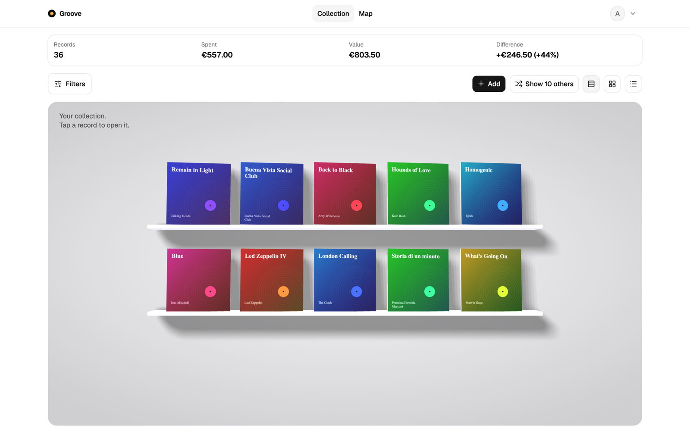
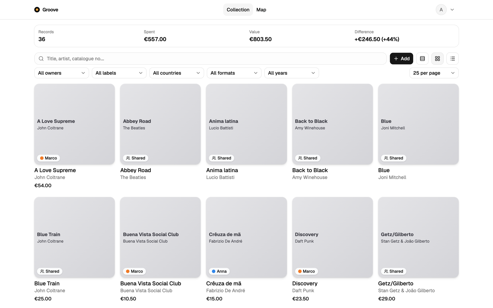
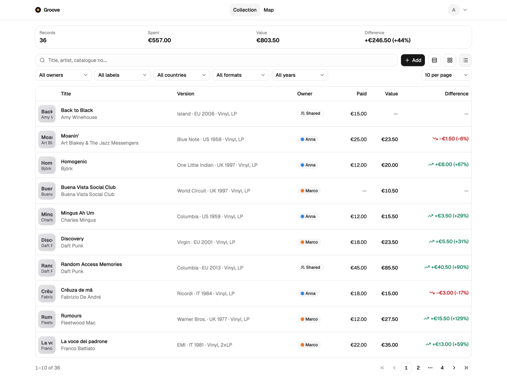
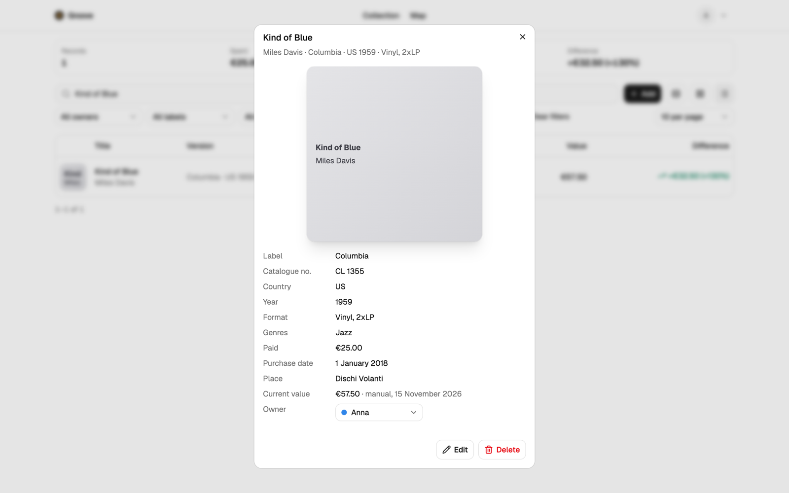
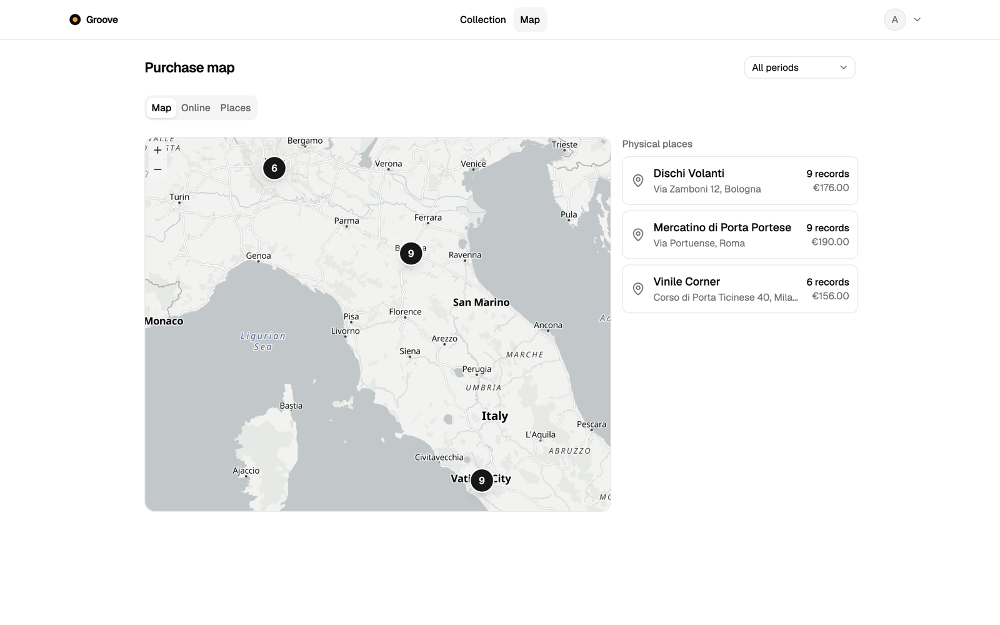
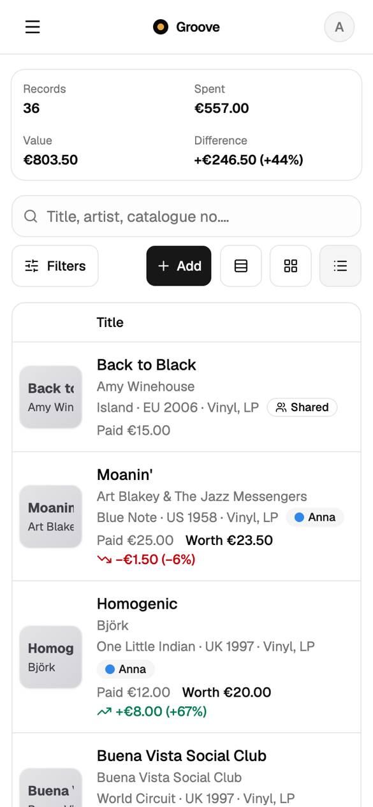
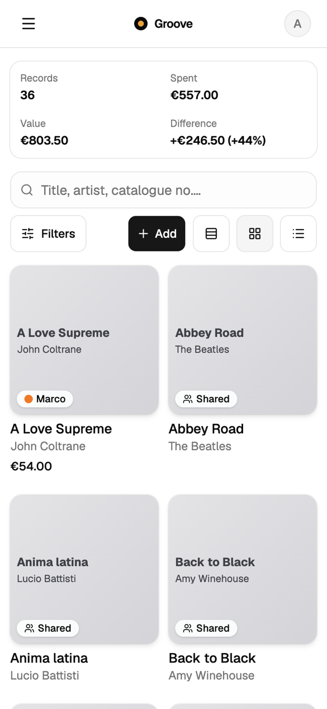

# Groove — the family vinyl collection

Groove is a private web app where one family (a *household*) keeps its shared vinyl collection.
Everyone can add, edit and search records, even from a phone while standing in a shop, to see at
once whether a record is already at home. Each member can link their own Discogs account from
Settings to import their collection and search Discogs; without it, everything works by hand.

| Part | Stack | Folder |
|---|---|---|
| Front end | React 19 · TypeScript · Vite · Tailwind 4 · shadcn (base-ui) · TanStack Query · zod | [`web/`](web/README.md) |
| API | Python 3.12 · FastAPI · SQLAlchemy 2 · Alembic | [`api/`](api/README.md) |
| Database | PostgreSQL 16 | — |
| Reverse proxy | Caddy (static files, `/api` proxy, automatic HTTPS) | `web/Caddyfile` |
| Specs and plans | OpenSpec (spec-driven workflow) | [`openspec/`](openspec/README.md) |
| Operations | Backup / restore / deploy scripts | [`scripts/`](scripts/README.md) |

**Documentation:** the [`docs/`](docs/README.md) folder explains how the app is built —
architecture, data model, API, UI design, security, Discogs, development workflow and
deployment. Instructions for AI coding agents are in the `CLAUDE.md` files
(start with the [root one](CLAUDE.md)).

## Features

- **Collection in three views:** a 3D shelf (10 random records, "show 10 more"), a grid that
  loads more as you scroll and a paged table (10, 25 or 50 per page), with search and filters
  (owner, genre, decade, label, country, format, year). On phones the filters live in a bottom
  sheet and the menu is a hamburger.
- **Complete record sheet:** besides title, artist, year, label, format and notes, every record
  has its **version** (catalogue number and country: two pressings of the same album are not
  duplicates), its **purchase** (price, currency, date, place, channel) and its **current value**
  (set by hand or taken from Discogs, with source and date). Gain or loss is shown per record and
  the collection totals are shown per currency.
- **Owners:** a record belongs to one member or is shared by the family. When a member leaves,
  their records become shared.
- **Places and map:** shops, markets and websites are shared by the family and can be physical,
  online or both. The **Map** page shows physical places, the list of online purchases, a year
  filter and place management (including "move the records and delete"). An address typed by a
  member is sent only to the geocoding service; the map only requests tiles.
- **Adding with Discogs:** with a linked account the search runs as you type (also by barcode or
  catalogue number), with paged results, an "already in the collection" marker and the value
  imported on selection. "Enter by hand" is always available.
- **Refreshing values:** from the account menu, "Refresh values" asks Discogs for the market value
  of linked records and shows what changed; a value entered by hand is never overwritten without
  confirmation.
- **Family:** the first person to register creates the household; others join with an invite
  link generated on the Family page. There is no e-mail: a forgotten password is reset with a
  one-time link created by another member.
- **Backup:** the collection can be exported and imported as a JSON file from Settings.
- **Languages:** Italian (default) and English.

## Screenshots

Demo data (made-up purchases and values, placeholder covers), English interface.

| The 3D shelf | Grid |
|---|---|
|  |  |
| **Table, 10 per page** | **Record** |
|  |  |
| **Purchase map** | **On a phone: table and grid** |
|    |

## Requirements

- [Docker](https://www.docker.com/) (or OrbStack) with Docker Compose
- [uv](https://docs.astral.sh/uv/) for running the API locally (it installs Python 3.12 itself)
- Node.js 20 or newer for running the front end locally

## Run everything with Docker

```bash
cp .env.example .env
```

Open `.env` and set at least `POSTGRES_PASSWORD`. The other values (Discogs, token encryption)
are explained in the file and in [Discogs](#discogs) below.

```bash
docker compose up --build
```

The app is at <http://localhost:8080>. Front end and API share the same origin (`/api`), so there
is no CORS. To check that the API answers:

```bash
curl http://localhost:8080/api/health
```

To stop everything while keeping the data in the volumes:

```bash
docker compose down
```

## Local development (API and front end outside Docker)

You need a reachable PostgreSQL. `docker-compose.dev.yml` starts only the database, on
`127.0.0.1:5432` (user, password and database: `groove`):

```bash
docker compose -f docker-compose.dev.yml up -d
```

API, in one terminal (applies the migrations, then starts):

```bash
cd api && uv sync && uv run alembic upgrade head && uv run uvicorn app.main:app --reload --port 8000
```

Front end, in another terminal (the dev server proxies `/api` to port 8000):

```bash
cd web && npm install && npm run dev
```

Open the URL Vite prints (usually <http://localhost:5173>). The interactive API docs are at
<http://localhost:8000/api/docs>. The first person who registers creates the household.

## Discogs

Each member links **their own** Discogs account from Settings → "Connect to Discogs". The link
unlocks importing the collection and searching Discogs on the "Add a record" screen; without it,
everything else works by hand.

Once, whoever installs the app must register it on Discogs:

1. Sign in to Discogs and open <https://www.discogs.com/settings/developers>.
2. Press **Create an Application**, choose a name (for example "Groove") and save.
3. Copy the **Consumer Key** and **Consumer Secret** into `.env` as `DISCOGS_CONSUMER_KEY` and
   `DISCOGS_CONSUMER_SECRET`.
4. Generate the key that encrypts the members' tokens and put it in `FERNET_KEY`:

   ```bash
   cd api && uv run python -c "from cryptography.fernet import Fernet; print(Fernet.generate_key().decode())"
   ```

5. Set `PUBLIC_BASE_URL` to the address you open the app with (for example
   `http://localhost:8080` locally, `https://groove.example.com` online). Discogs sends the browser
   back to `PUBLIC_BASE_URL/api/discogs/callback`, so no tunnel is needed locally.
6. Restart the API (`docker compose up -d`).

Keep `.env` and `FERNET_KEY` safe: without the key the saved links can no longer be read (members
just reconnect Discogs). Credentials and tokens stay on the server: they never appear in API
responses or in the front-end code (a test checks this).

Notes:

- **Import** runs in the background; the page can be closed and the job resumes by itself if the
  API restarts. Discogs allows about 60 requests per minute, so 500 records take a few minutes.
  Running it again only adds new records, never touches edits made in the app and never deletes.
- **Covers** taken from Discogs are stored on the server and shown only to signed-in members. The
  images belong to their creators: use is private, within the family — do not publish the app.
  Members can also upload their own covers.
- **Market value** is the lowest price for sale on Discogs for the record's release (in the
  currency Discogs reports); if no copy is for sale, no value is invented.
- **Tests never use the real Discogs:** they use a fake (`api/tests/discogs_mock.py` for the API,
  `api/scripts/mock_discogs.py` for browser tests).

More detail: [docs/discogs.md](docs/discogs.md).

## Deploying to your own server (VPS)

You need a Linux server with Docker and Docker Compose, a domain pointing to it (DNS `A` record)
and ports 80 and 443 open.

1. Copy the project to the server and create `.env` (`cp .env.example .env`). Set:
   - `POSTGRES_PASSWORD` to a long password;
   - `FERNET_KEY`, `DISCOGS_CONSUMER_KEY`, `DISCOGS_CONSUMER_SECRET` as in [Discogs](#discogs);
   - `SITE_ADDRESS=groove.example.com` (your domain): Caddy obtains and renews the HTTPS
     certificate by itself;
   - `PUBLIC_BASE_URL=https://groove.example.com`: with `https` the session cookie becomes
     `Secure` and Discogs sends the browser back here;
   - `HTTP_PORT=80` and `HTTPS_PORT=443`.
2. Start it, giving the images a version (needed to roll back):

   ```bash
   APP_VERSION=2026-11-13 docker compose up -d --build
   ```

   Database migrations run automatically every time the API starts. Services restart by
   themselves after a server reboot.
3. Open `https://groove.example.com`: the first person who registers creates the household, then
   invites the others from the Family page.
4. Check the API: `curl https://groove.example.com/api/health`.

Data lives in the Docker volumes `dbdata` (database) and `covers` (cover images); `caddy_data`
keeps the certificates. **Never run `docker compose down -v`: it deletes the data.**

CI (`.github/workflows/ci.yml`) can also build images and deploy automatically over SSH with
`scripts/deploy.sh`; see [.github/DEPLOY.md](.github/DEPLOY.md) and
[docs/deployment.md](docs/deployment.md).

### Backup

```bash
scripts/backup.sh
```

Saves the database and the covers in `backups/<date-time>/`. To run it every night, add this to
`crontab -e` (with your project path):

```bash
0 3 * * * cd /path/to/project && scripts/backup.sh >> backups/backup.log 2>&1
```

Copy the `backups/` folder off the server now and then: a backup on the same disk does not
protect against losing the disk.

### Restore

```bash
scripts/restore.sh backups/20261113-030000
```

It asks for confirmation, then replaces the database and the covers with the backup and restarts
everything.

### Upgrading and rolling back

Upgrade: bring the new code to the server and rebuild with a new version.

```bash
scripts/backup.sh
```

```bash
APP_VERSION=2026-12-01 docker compose up -d --build
```

Roll back to the previous version (the old images stay on the server):

```bash
APP_VERSION=2026-11-13 docker compose up -d --no-build
```

Database migrations only go forward. If a new version applied one that the old version does not
understand, roll back by restoring the backup taken before the upgrade.

## Tests and checks

All test suites need the dev database running (`docker compose -f docker-compose.dev.yml up -d`).

```bash
cd api && uv run ruff check . && uv run pytest
```

```bash
cd web && npm run lint && npm test && npm run build
```

```bash
cd web && npm run schemas:check
```

Browser tests (Playwright) start their own API, front end and fake Discogs on a `groove_e2e`
database recreated on every run. The first time, install Chromium:

```bash
cd web && npx playwright install chromium
```

```bash
cd web && npm run e2e
```

The full journey (registration, invite, manual record, fake Discogs, import, three views, shelf)
starts from an empty database and runs on its own:

```bash
cd web && npm run e2e:release
```

See [docs/development.md](docs/development.md) for the workflow and conventions.

## Languages

The app is in **Italian** (default) and **English**. The language can be changed from the Account
menu and from Settings, and also chosen before signing in. It is saved per member on the server
(`users.language`), so it follows them across devices; without a choice the browser language is
used, then Italian. Dates, numbers and currencies follow the language (`web/src/i18n/format.ts`).

Texts live in `web/src/i18n/locales/it.ts` (complete: it is the model and the fallback) and
`en.ts`. A test (`no-literal-text.test.ts`) forbids writing user-facing text directly in
components.

### Adding a language

Example: French, `fr`.

1. Copy `web/src/i18n/locales/en.ts` to `fr.ts`, rename `en` to `fr` and translate the values (the
   `Catalog` type reports every missing key).
2. In `web/src/i18n/index.ts` add `'fr'` to `LANGUAGES`, import the catalog into `catalogs` and add
   `fr: 'fr-FR'` to `LOCALES`.
3. In `web/src/shared/components/LanguageSelect.tsx` add the language name (`fr: 'Français'`).
4. In `api/app/schemas/accounts.py` add `"fr"` to the `Literal` of `PreferencesIn.language`, then
   run `cd web && npm run schemas`.
5. Run `npm run build` and `npm test`: if something is missing, the compiler tells you where.

## Secrets

No secret goes into the repository. `.env` is ignored by git; `.env.example` holds only variable
names. The Discogs application credentials and the members' tokens stay on the server and never
reach the browser.
