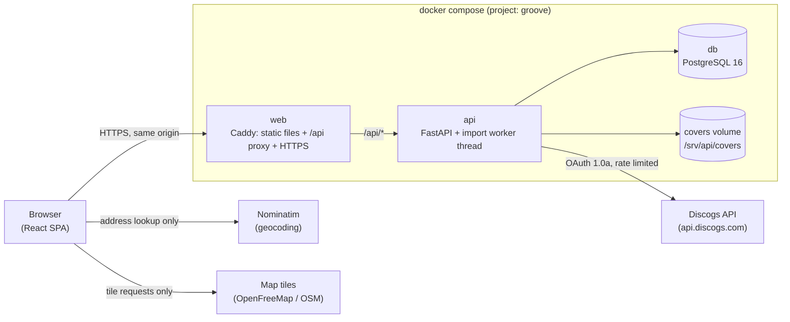
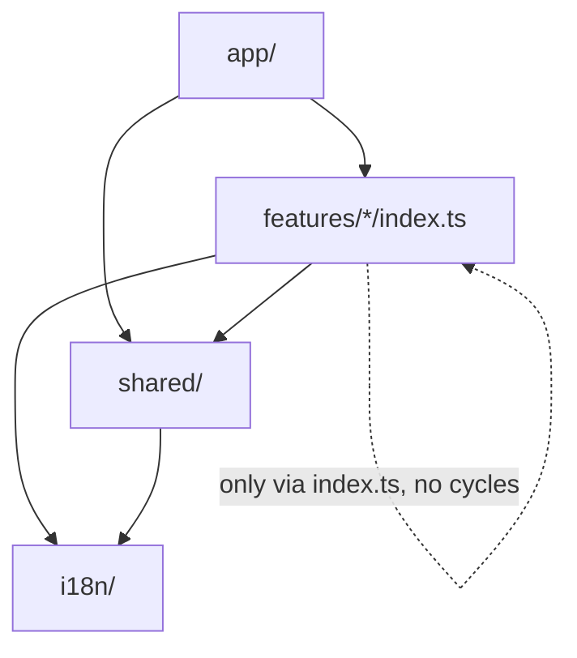
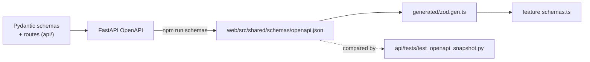

# Architecture

Groove is a classic three-tier web app packaged with Docker Compose: a React single-page app, a
FastAPI service and PostgreSQL, behind a Caddy reverse proxy that serves everything from **one
origin**.

## System overview



Key consequences of this shape:

- **No CORS.** The SPA and the API share an origin; `/api/*` is proxied by Caddy (prod) or Vite
  (dev). Cookies are first-party, `SameSite=Lax`.
- **The browser never talks to Discogs.** All Discogs calls (search, import, covers, values) go
  through the API with the member's encrypted token. Secrets never reach the browser.
- **The browser does talk to two public services:** Nominatim for geocoding addresses typed by a
  member, and map tile servers. Nothing else about the collection leaves the server.

## Containers and volumes

| Service | Image | Role | Volume |
|---|---|---|---|
| `db` | `postgres:16-alpine` | Data | `dbdata` |
| `api` | built from `api/Dockerfile` | FastAPI on port 8000; runs `alembic upgrade head` on start | `covers` → `/srv/api/covers` |
| `web` | built from `web/Dockerfile` | Caddy serving `web/dist` and proxying `/api` | `caddy_data` (certificates) |

Ports: `HTTP_PORT` (default 8080) and `HTTPS_PORT` (default 8443) on the host. Health checks gate
startup order: `db` healthy → `api` healthy → `web`.

In development the same topology is reproduced without Caddy: Vite on 5173 proxies `/api` to
uvicorn on 8000, and `docker-compose.dev.yml` runs only Postgres on `127.0.0.1:5432`.

## Request lifecycle

```mermaid
sequenceDiagram
    participant C as Component
    participant Q as TanStack Query
    participant A as api() helper
    participant MW as CSRF middleware
    participant R as Router
    participant D as get_current_user
    participant S as Service
    participant DB as PostgreSQL

    C->>Q: useQuery / useMutation
    Q->>A: api(path, { schema })
    A->>MW: fetch (cookie + X-Requested-With: groove on non-GET)
    MW->>R: header ok (else 403 csrf_header_missing)
    R->>D: Depends(get_current_user)
    D->>DB: session by token hash
    D-->>R: User (else 401 not_authenticated)
    R->>S: service.fn(db, user, body)
    S->>DB: queries scoped to user.household_id, commit
    S-->>R: model / schema
    R-->>A: JSON (response_model)
    A->>A: zod safeParse (else ResponseShapeError)
    A-->>Q: typed data
    Q-->>C: render; mutations call invalidateCollection()
```

Errors travel the same path in reverse as `{ code, detail, field? }`; the front end translates
`code` with `errorMessage(err, fallback)`. See [api.md](api.md).

## Back end (`api/`)

### Layers

Calls go **down only**:

```
app/api/routers/   HTTP layer: parse request, call ONE service function, return a schema.
                   No queries, no business rules, no commit.
app/services/      Business rules and queries. Take (db, user, ...), commit, raise AppError.
app/integrations/  External HTTP clients (Discogs). Pure mapping functions. No DB.
app/models/        SQLAlchemy 2 tables, one file per domain.
app/schemas/       Pydantic request/response models, one file per domain.
app/core/          config, db, security, crypto, errors, money, clock. Imports nothing above.
```

`app/main.py` builds the app: CSRF middleware, `/api/health`, router registration, the
validation-error handler (maps Pydantic errors to `required` / `invalid` + `field`), the
`AppError` handler, and the `lifespan` that starts the background worker.

### Domains

| Domain | Router | Services | Models |
|---|---|---|---|
| Accounts & sessions | `auth.py` | `accounts.py`, `password_resets.py` | `User`, `Session`, `LoginAttempt`, `PasswordReset` |
| Household | `household.py`, `invites.py` | `households.py`, `invites.py` | `Household`, `Invite` |
| Collection | `records.py` | `collection.py`, `records.py`, `covers.py` | `Record` |
| Places & map | `locations.py`, `purchases.py` | `locations.py`, `purchases.py` | `Location` |
| Discogs | `discogs.py` | `discogs_connection.py`, `discogs_search.py`, `importer.py` | `DiscogsConnection`, `DiscogsOAuthPending`, `ImportJob` |
| Backup | `backup.py` | `backup.py` | — |
| Housekeeping | — | `housekeeping.py` | — |

`services/records.py` holds shared helpers (normalisation, filters, serialisation, duplicate
detection, summaries); `services/collection.py` holds the record use cases (list, create, update,
soft delete/undo, value refresh, covers).

### Background worker

`services/importer.py` defines `Worker`, **one daemon thread** started in `main.lifespan`
(disabled in tests with `import_worker_enabled=False`). Every `import_poll_seconds` it:

1. runs every `pending` / `running` `ImportJob` (`process_jobs`), one page at a time, committing
   after each page and storing `next_page`, so a restart resumes where it stopped;
2. once per `housekeeping_seconds`, purges expired sessions, old login attempts and stale OAuth
   starts (`housekeeping.purge_expired`).

There is no separate queue or broker: job state lives in PostgreSQL. This keeps the deployment to
three containers; the trade-off is that the API must run as a **single process** (one worker
thread per process).

### Files on disk

Cover images (front and back) are validated, cropped to a square JPEG of `cover_size` px and
stored under `settings.covers_dir` by `services/covers.py`. They are served by the API only to
signed-in members of the household, with `ETag` and `Cache-Control: private`.

## Front end (`web/`)

### Structure

```
src/app/             shell: main.tsx, App.tsx (router table), Layout, SiteHeader,
                     RequireAuth, LanguageProvider, LegacyRedirect. Nothing imports from here.
src/features/<name>/ one folder per domain, public surface = index.ts
                     auth · collection · records · discogs · places · family · settings · shelf
src/shared/          ui/ (shadcn primitives), components/, hooks/, lib/, schemas/
                     never imports features or app
src/i18n/            catalogs (it.ts, en.ts), t, formatting helpers
e2e/                 Playwright tests
```

Import rules are enforced by `src/architecture.test.ts`:



### Features

| Feature | Owns |
|---|---|
| `auth` | Sign-in, register, join by invite, password reset, `AuthProvider`, language hook |
| `collection` | Home page: filter bar, shelf/grid/list views, summary totals, URL-driven filter state |
| `records` | Record dialog/detail, add-record page, covers, owner badge/select, value refresh dialog |
| `discogs` | Discogs search step in the add flow, import page |
| `places` | Map page (`/map`), location dialog/picker, geocoding |
| `family` | Members, invites, password-reset links |
| `settings` | Profile, language, currency, password, Discogs connection, backup |
| `shelf` | The framework-free three.js 3D shelf scene |

### Data flow

- **Server state** is TanStack Query only. Every call goes through `api(path, { schema })`, which
  adds the CSRF header, parses JSON and validates it with zod (generated from the API's OpenAPI).
- **After a mutation** on records or locations, `invalidateCollection(queryClient)` refreshes
  every query that shows them (`records`, `record`, `records-options`, `records-summary`,
  `places`, `locations`, `quick-search`).
- **UI state that should survive a reload** (search, filters, sort, page, view) lives in the URL.
- **Routing:** `routes.ts` is the single list of URLs; old Italian URLs redirect to English ones
  via `legacyRedirects`. Rarely used pages are lazy-loaded. Record detail and settings render as
  dialogs **on top of** the collection (`OnCollection` in `App.tsx`).

### Contract between the two sides



Changing a Pydantic model or route without regenerating breaks `test_openapi_snapshot.py` and
`npm run schemas:check` (also run in CI). Both sides are committed together.

## Cross-cutting decisions

| Decision | Why |
|---|---|
| One household per installation (unique index on a constant) | The app is private to one family; it removes a whole class of tenancy bugs while keeping `household_id` scoping in place. |
| Money as integer minor units + ISO currency | No float rounding; totals are per currency, never converted. |
| Purchase and value as columns on `records` | One purchase per record; avoids joins on every list. |
| Soft delete with a short undo window | "Undo" after deleting; `deleted_at` filtered everywhere. |
| Normalised `title_key` / `artist_key` + trigram indexes | Accent- and punctuation-insensitive search, sorting and duplicate matching. |
| DB-backed worker thread instead of a queue | Fewer moving parts; resumable imports. |
| Server-side aggregates (`/records/summary`, `/records/options`) | Totals and filter values cover the whole collection, not just the loaded page. |
| Generated zod schemas | The browser rejects unexpected shapes instead of rendering garbage. |
| Error `code` contract, translated client-side | API stays English; UI language is a client concern. |
| English code, Italian default UI | Code readable by anyone; the family's language in the UI. |
