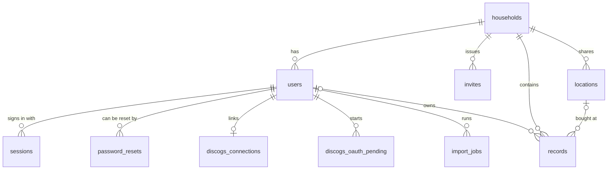

# Data model

PostgreSQL 16, mapped with SQLAlchemy 2 (`api/app/models/`), migrated with Alembic
(`api/alembic/versions/`). Primary keys are UUIDs unless noted; timestamps are `timestamptz`.

## Entity relationships

## Tables

### Accounts (`models/accounts.py`)

| Table | Purpose | Notes |
|---|---|---|
| `households` | The family | **At most one row**: unique index on the constant `(true)`. |
| `users` | Members | Unique `email`; argon2 `password_hash`; `display_name`; `default_currency` (suggested for new prices); `language` (`it` / `en`, `NULL` until chosen). |
| `invites` | Join links | Only `token_hash` (SHA-256) stored; `expires_at`, `used_at`, `revoked_at`. |
| `password_resets` | One-time reset links created by another member | Only `token_hash`; valid `reset_hours` (24 h); a new link supersedes the previous one. |
| `sessions` | Sign-in sessions | PK is the token hash; `expires_at` (`session_days`, 30 days). |
| `login_attempts` | Rate limiting | Integer PK; indexed on `(email, attempted_at)`. |

### Collection (`models/records.py`)

`records` is the central table. Column groups:

| Group | Columns |
|---|---|
| Identity | `id`, `household_id`, `title`, `artist`, `year`, `label`, `genres` (text array), `format`, `note` |
| Version (pressing) | `catalog_no`, `country` |
| Purchase | `purchase_amount_minor`, `purchase_currency`, `purchase_date`, `purchase_location_id` → `locations` (`ON DELETE RESTRICT`), `purchase_channel` |
| Value | `value_amount_minor`, `value_currency`, `value_source` (`manual` / `discogs`), `value_measure` (e.g. `lowest_price_for_sale`), `value_fetched_at`, `value_num_for_sale` |
| Ownership | `owner_id` → `users` (`ON DELETE SET NULL`; `NULL` = shared), `created_by` |
| Media | `cover_path`, `back_cover_path`, `tracklist` (JSONB, cached from Discogs) |
| Discogs link | `discogs_release_id`, `discogs_username`, `discogs_instance_id` |
| Search keys | `title_key`, `artist_key` (normalised copies) |
| Lifecycle | `created_at`, `updated_at`, `deleted_at` (soft delete) |

Indexes:

- `uq_records_discogs_instance` — unique `(discogs_username, discogs_instance_id)` where the
  instance id is set: re-importing never creates the same item twice.
- GIN trigram indexes on `title_key` and `artist_key` (and, created in a migration only, on
  `lower(coalesce(catalog_no, ''))`) for fuzzy search.
- Partial indexes `(household_id, artist_key, title_key, id)` and
  `(household_id, created_at, id)` where `deleted_at IS NULL`, for paging the default and
  "recently added" orders.

### Places (`models/locations.py`)

`locations`: `name`, `kind` (`physical` / `online` / `both`), optional `address`, `lat`, `lng`,
`url`. Shared by the household. A location in use cannot be deleted directly (`in_use`); the API
offers *reassign the records, then delete*.

### Discogs (`models/discogs.py`)

| Table | Purpose |
|---|---|
| `discogs_connections` | One per member (PK `user_id`): `discogs_username`, Fernet-encrypted token and secret, `status` (`active` / `expired`). |
| `discogs_oauth_pending` | Request tokens waiting for the member to authorise on Discogs (secret encrypted). |
| `import_jobs` | Background imports: `status` (`pending` / `running` / `done` / `failed`), `total`, `processed`, `added`, `next_page`, `message` (an error code), `shared` (imported records get no owner). |

## Invariants and rules

- **Household scoping.** Every query on member data filters by `user.household_id`. A row of
  another household is answered as *not found* (404), never *forbidden*.
- **Soft delete.** Deleting a record sets `deleted_at`; `POST /records/{id}/restore` undoes it
  within `undo_seconds` (10 s), else `undo_expired`. Every read filters `deleted_at IS NULL`.
- **Money.** Amounts are `BigInteger` minor units with a 3-letter ISO currency next to them.
  Conversion helpers: `api/app/core/money.py`, `web/src/shared/lib/money.ts`. Totals are grouped
  by currency, never converted.
- **Normalised keys.** `normalise()` in `services/records.py` lowercases, strips accents and
  punctuation and collapses spaces. Always write `title_key` / `artist_key` through it.
- **Duplicates.** A new record is a duplicate if it has the same Discogs release, or the same
  normalised title and artist **and** the same pressing (catalogue numbers equal, or both empty).
  The API answers `409 duplicate` with the existing record.
- **Owners.** `owner_id` must be a member of the same household (`invalid_owner`). When a member
  leaves, the FK sets their records to shared.
- **Channel.** A `physical` or `online` place implies the purchase channel; only a `both` place
  uses the channel sent by the client.
- **Value source.** A `manual` value is never replaced by a Discogs refresh unless the client
  explicitly asks (`replace_manual`); otherwise the API returns a *proposal*.
- **Time.** Application code uses `app.core.clock.utcnow()`; tests patch it.

## Migrations

- Add a new revision with `uv run alembic revision --autogenerate -m "what_changed"` and review it.
- **Never edit an applied revision**; fix mistakes with a new one.
- New `NOT NULL` columns need a `server_default` or a backfill.
- The API container runs `alembic upgrade head` on every start, so migrations must work on a live
  database. In practice migrations only go forward; rollback = restore a backup.
- `tests/core/test_migrations.py` runs every revision from scratch.
