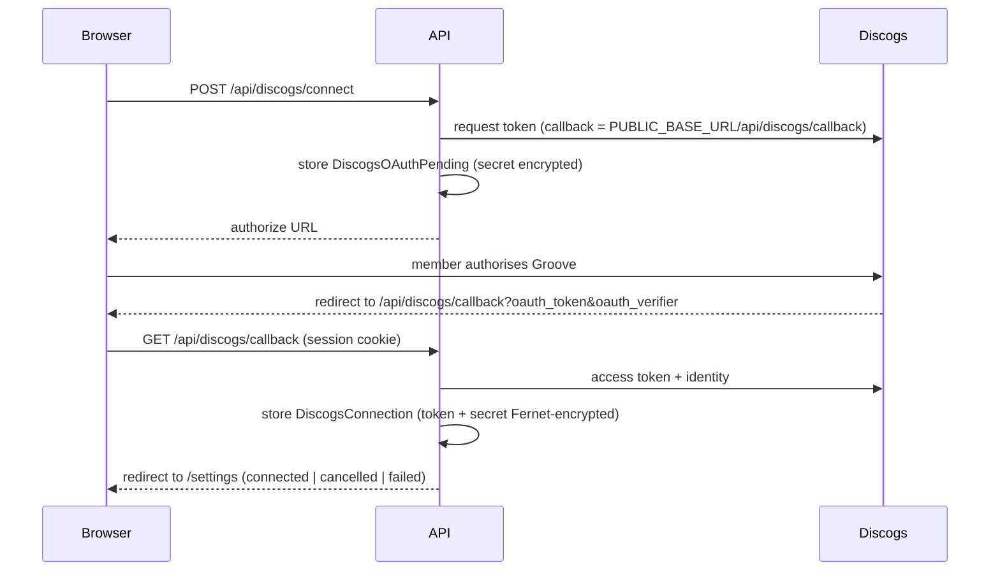
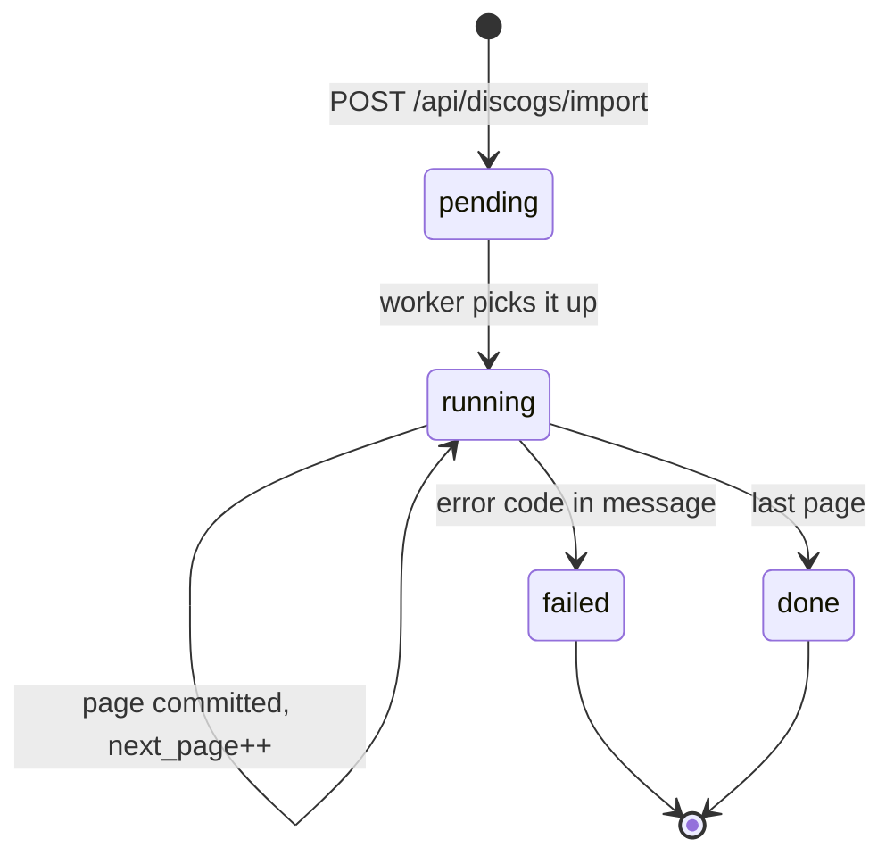

# Discogs integration

Discogs is optional. Without it the app works fully by hand; with it a member can search
releases, import their Discogs collection, fetch covers and tracklists, and read market values.

## Pieces

| Piece | File | Role |
|---|---|---|
| HTTP client | `api/app/integrations/discogs/client.py` | OAuth 1.0a signing (PLAINTEXT over HTTPS), shared sliding-window rate limiter, retries with backoff, typed errors |
| Mapping | `api/app/integrations/discogs/mapping.py` | Discogs payload → record fields. All payload knowledge lives here. |
| Connection | `api/app/services/discogs_connection.py` | OAuth flow, status, disconnect, starting imports |
| Search & media | `api/app/services/discogs_search.py` | Search results matched with the collection, covers, tracklists, release value |
| Import | `api/app/services/importer.py` | DB-backed worker that imports a collection page by page |
| Router | `api/app/api/routers/discogs.py` | Thin HTTP layer under `/api/discogs` |
| Front end | `web/src/features/discogs/` | Search step in the add flow, import page |
| Fakes | `api/tests/discogs_mock.py`, `api/scripts/mock_discogs.py` | Used by pytest and Playwright; tests never hit the real Discogs |

## Configuration

`DISCOGS_CONSUMER_KEY`, `DISCOGS_CONSUMER_SECRET` and `FERNET_KEY` must all be set for Discogs to
count as configured (`Settings.discogs_configured`); otherwise the API answers
`discogs_not_configured` and the UI hides Discogs actions. `PUBLIC_BASE_URL` builds the OAuth
callback (`/api/discogs/callback`). Other knobs in `core/config.py`: `discogs_rate_per_minute`
(55), `discogs_max_retries` (4), `discogs_backoff_seconds` (2.0), `import_page_size` (100).

## Connecting (per member)

Each member links **their own** account; the household never shares a token. When Discogs
rejects a token (401) the connection is marked `expired` and the API answers `discogs_expired`
until the member reconnects. Disconnecting deletes the stored authorisation and stops running
imports; imported records stay.

## Search

`GET /api/discogs/search?q=&page=` searches releases (artist, title, catalogue number; 8–14 digit
queries are treated as barcodes) and marks results already in the collection. Choosing a result
pre-fills the add form; `GET /api/discogs/releases/{id}/value` fetches the market value.

## Import

- One import at a time per member; starting another returns the running one.
- The worker processes `import_page_size` items per page and commits after each page, saving
  `next_page`, so an API restart resumes the job.
- Inserts are idempotent thanks to the unique index on `(discogs_username, discogs_instance_id)`:
  an item imported before is left alone (including any edits made in the app). Nothing is ever
  deleted.
- `shared=true` imports records with no owner; otherwise the importing member is the owner.
- Failure codes stored in `message` and translated by the UI: `account_disconnected`,
  `authorisation_rejected`, `private_collection`, `discogs_unavailable`, `discogs_error`.
- A cover that cannot be downloaded never blocks the import.

At ~55 requests per minute, a 500-record collection takes a few minutes.

## Covers and tracklists

- Covers are downloaded only from Discogs image hosts (and the configured API host, which is the
  mock in tests); any other URL is `bad_cover_url`. They are re-encoded and stored like uploads
  (see [security.md](security.md)).
- The tracklist is fetched the first time it is requested and cached on the record (`tracklist`
  JSONB).

## Market value

The value is the **lowest price for sale** for the record's release on the Discogs marketplace
(`value_measure = "lowest_price_for_sale"`), in the currency Discogs reports, with
`value_num_for_sale` and `value_fetched_at`. If nothing is for sale, no value is invented
(`status: "no_value"`). A `manual` value is replaced only when the client sends
`replace_manual=true`; otherwise the refresh answers `status: "proposal"`.

## Testing

- pytest: `api/tests/discogs_mock.py` plugs a fake transport into the client
  (`set_transport`); `conftest.py` sets fake credentials and a random `FERNET_KEY`, and disables
  the worker (tests call `run_job` / `process_jobs` directly).
- Playwright: `api/scripts/mock_discogs.py` runs a fake Discogs on port 8020 (OAuth, a
  230-record collection, search) and the e2e API points `discogs_api_url` at it.
